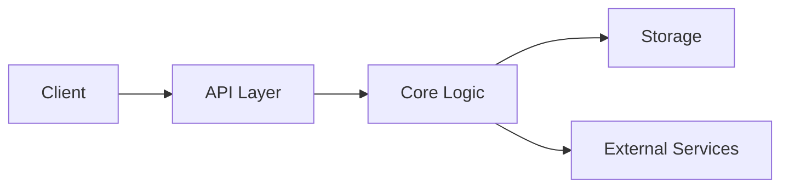

## Overview

LambShock is built around a small set of ideas that you can combine to fit your workflow. This page introduces the core terminology, the high-level architecture, and the main entities you will work with as you build and customize your implementation.

This starter kit is intentionally generic. You can adapt the names, data shapes, and operational details to match your product without changing the overall structure of the documentation.

<Callout kind="info">

This page is a template for documentation authors. Replace examples, labels, and workflows with your own product-specific details.

</Callout>

## Core terminology

Use the terms below as a shared vocabulary when you read the rest of the docs.

<Columns cols={2}>
  <Card title="Project" icon="book-open" href="#architecture-overview">
    
Your top-level workspace or application boundary. It groups configuration, data, and behavior.
    
  </Card>
  <Card title="Entity" icon="database" href="#key-entities">
    
A named record or object that your system stores, reads, or updates.
    
  </Card>
  <Card title="Component" icon="settings" href="#how-components-work-together">
    
A reusable unit that handles one responsibility, such as routing, formatting, or persistence.
    
  </Card>
  <Card title="Workflow" icon="arrow-right" href="#common-usage-patterns">
    
A repeatable sequence of actions that moves data from input to output.
    
  </Card>
</Columns>

## Architecture overview

LambShock works best when you think in layers. You define inputs at the edge, transform them in the middle, and store or emit results at the end. That separation helps you test, swap, and extend parts of the system without rewriting everything.



The architecture usually follows this path:

1. A client sends a request or triggers an event.
2. The API layer validates the input and routes it.
3. Core logic applies rules and builds the result.
4. Storage or external services persist or deliver the outcome.

## Key entities

The exact objects in your implementation may differ, but most systems built with LambShock use a similar model.

| Entity | Purpose | Example responsibility |
|--------|---------|------------------------|
| Project | Holds the overall configuration and scope | Defines environment-specific settings |
| Resource | Represents a managed item in the system | Stores metadata for a customer or document |
| Event | Captures something that happened | Records a status change or user action |
| Handler | Processes a request or event | Converts input into a response |

A good mental model is to treat entities as data, handlers as behavior, and workflows as the connection between them.

## How components work together

<Steps>
  <Step title="Receive input" icon="download">
    
You start with a request, event, or user action. At this stage, you only care about shape, validity, and intent.
    
  </Step>
  <Step title="Validate and normalize" icon="shield">
    
You check required fields, convert formats, and remove ambiguity so the rest of the pipeline can work predictably.
    
  </Step>
  <Step title="Apply business rules" icon="settings">
    
Your core logic decides what should happen next. This is where you enforce policy, defaults, and transformations.
    
  </Step>
  <Step title="Persist or return output" icon="check-circle">
    
You save results, emit events, or send a response back to the caller.
    
  </Step>
</Steps>

This pattern keeps your system easy to reason about. Each stage does one job, and each job has a clear contract.

## Common usage patterns

<Tabs>
  <Tab title="Read model" icon="database">
    
Use this pattern when you mostly retrieve information. Your logic should optimize for predictable reads and lightweight transformation.

```javascript
const project = {
  id: "proj_2048",
  name: "Northwind Analytics",
  status: "active",
  updatedAt: "2026-02-14T10:30:00Z"
};

function getProjectSummary(item) {
  return {
    id: item.id,
    name: item.name,
    status: item.status
  };
}

console.log(getProjectSummary(project));
```
    
  </Tab>
  <Tab title="Command flow" icon="arrow-right">
    
Use this pattern when you change state. Validate first, then execute a focused action, then confirm the result.

```javascript
async function archiveResource(resourceId) {
  const response = await fetch("https://api.example.com/resources/archive", {
    method: "POST",
    headers: {
      "Content-Type": "application/json"
    },
    body: JSON.stringify({
      resourceId,
      archivedAt: new Date().toISOString()
    })
  });

  if (!response.ok) {
    throw new Error("Archive request failed");
  }

  return response.json();
}
```
    
  </Tab>
  <Tab title="Event-driven" icon="zap">
    
Use this pattern when one action should trigger several downstream tasks. You emit an event once and let listeners react independently.

```javascript
const event = {
  type: "resource.updated",
  id: "res_7812",
  occurredAt: "2026-02-14T10:45:00Z"
};

function publishEvent(message) {
  console.log("Publishing event:", message.type);
}

publishEvent(event);
```
    
  </Tab>
</Tabs>

## Working with the API

<CodeGroup tabs="JavaScript,Python,cURL">
  ```javascript
  const response = await fetch("https://api.example.com/v1/projects/proj_2048", {
    headers: {
      "Authorization": "Bearer YOUR_TOKEN"
    }
  });

  const data = await response.json();
  console.log(data);
  ```
  ```python
  import requests

  response = requests.get(
      "https://api.example.com/v1/projects/proj_2048",
      headers={"Authorization": "Bearer YOUR_TOKEN"}
  )

  data = response.json()
  print(data)
  ```
  ```bash
  curl -X GET "https://api.example.com/v1/projects/proj_2048" \
    -H "Authorization: Bearer YOUR_TOKEN"
  ```
</CodeGroup>

The example above uses a placeholder token and a realistic endpoint shape. Replace the token format and resource path with the conventions used in your own deployment.

## Implementation notes

<Expandable title="Why these concepts matter" default-open="true">

A shared conceptual model reduces confusion across implementation, support, and onboarding. When you use the same terms consistently, you make documentation easier to scan and easier to maintain.

</Expandable>

<Expandable title="How to customize this template" default-open="false">

Rename entities to match your domain, update the architecture diagram to reflect your system, and replace the sample code with real integration examples. Keep the structure if you want readers to move from concept to practice quickly.

</Expandable>

<Callout kind="tip">

If you are writing new pages, link back to these concepts whenever you introduce a new term. That keeps your docs self-contained and easier to navigate.

</Callout>